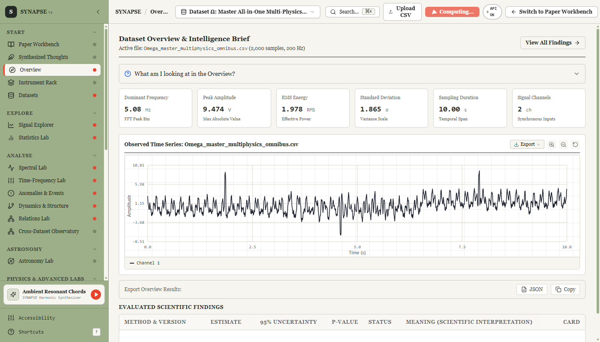
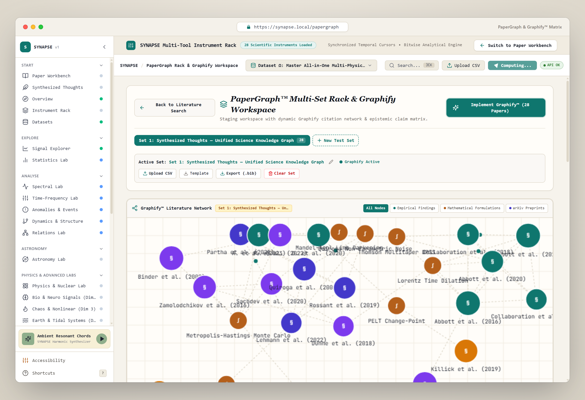
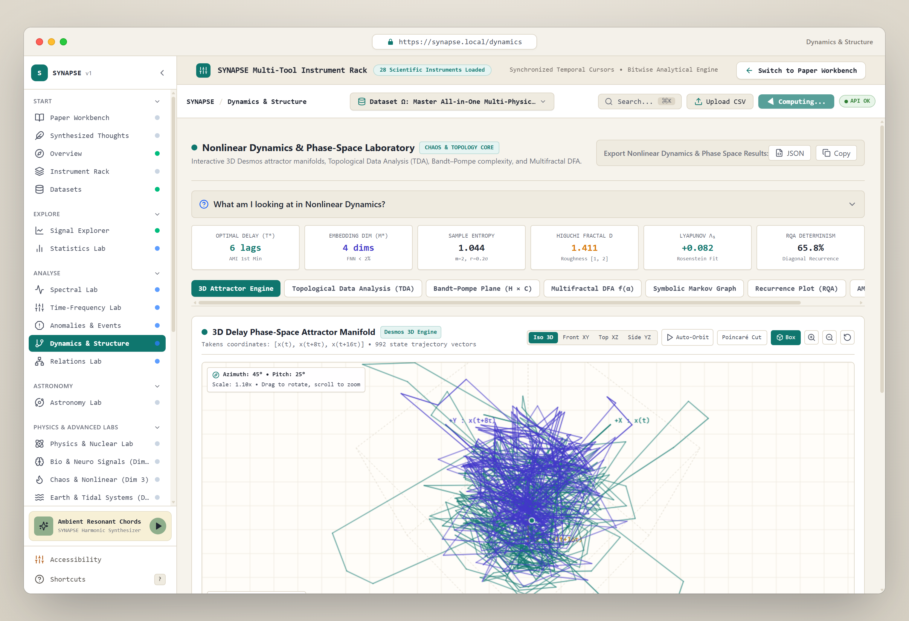
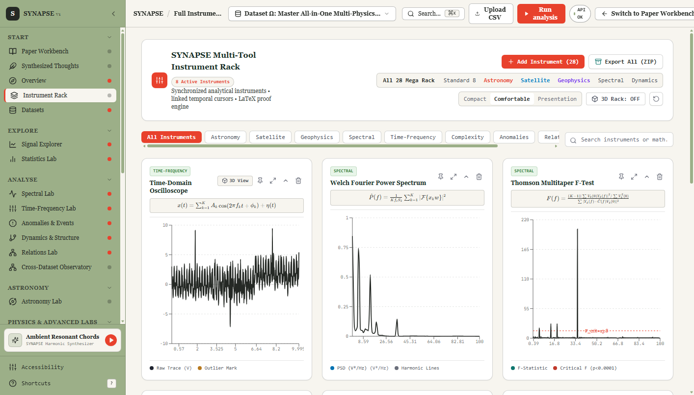
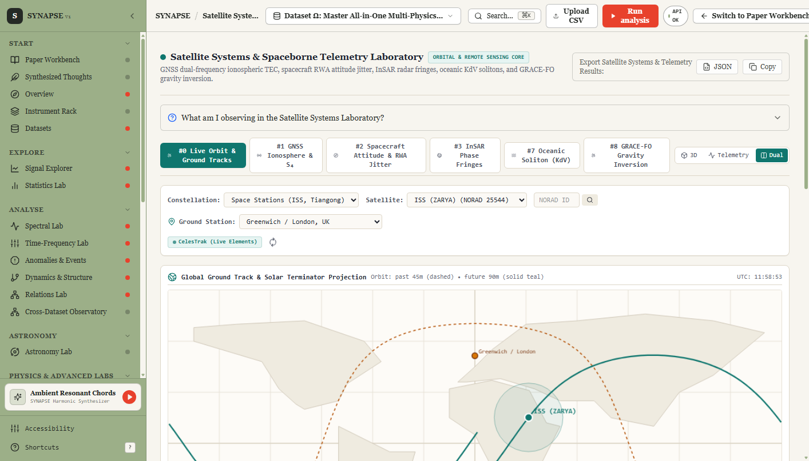

# SYNAPSE — Synthesized Thoughts

> **An open-source scientific workstation and research environment for discovering repeating patterns, abrupt regime changes, and hidden relationships in numerical time-series data, with native hypothesis synthesis.**

[](LICENSE)
[](https://python.org)
[](https://fastapi.tiangolo.com)
[](https://react.dev)
[](https://www.typescriptlang.org)
[](tests/)
[](BENCHMARKS.md)
[](https://github.com/Chauhan-legacy/Synapsev1/actions)

---

## The 10-Second Pitch

Drop in a sensor feed, audio trace, or physical telemetry log (CSV, TSV, Parquet, NPY, HDF5). 

Instead of writing 100 lines of boilerplate matplotlib code to clean timestamps, compute Welch periodograms, tune changepoint penalties, and test Granger causality, **SYNAPSE runs the full analysis pipeline automatically**:

- Finds harmonic tones with sub-bin precision (Thomson multitaper DPSS).
- Detects structural shifts in mean or variance without parameter guessing (PELT & BOCPD).
- Isolates true impulse spikes without masking distortion (Generalized Rosner ESD).
- Computes cross-channel lead/lag causality with False Discovery Rate (FDR) control.
- Reconstructs 1D signals into interactive 3D phase-space attractors (Takens embedding).
- Links findings directly to foundational peer-reviewed preprints via arXiv.
- Synthesizes findings into qualitative research entries via **Synthesized Thoughts**.



---

## Synthesized Thoughts — The Research Diary

**Synthesized Thoughts** is a dedicated research journal engineered to bridge quantitative signal analysis with qualitative scientific hypothesis formulation. 

Designed with a warm editorial aesthetic inspired by physical laboratory notebooks, it provides a focused, distraction-free space for researchers to record observations, document transient anomalies, and articulate conclusions alongside numerical telemetry.


### What It Does
- **Distraction-Free Editorial Writing**: Provides an uncluttered writing surface formatted to standard A4 sheet proportions, rendered in a calming sage green (`#82a18f`) on a warm drafting surface (`#EAE5DC`) with Georgia typography.
- **Instant Telemetry & Reading Metrics**: Computes real-time word counts, character counts, and estimated reading times as notes are drafted.
- **Publication-Ready Canvas Export**: Includes a high-resolution 2x HTML5 Canvas rasterization engine that exports notes directly to publication-grade PNG and high-quality JPEG images without external dependencies.
- **Local-First Privacy & Zero Telemetry**: Operates strictly client-side using localStorage persistence. Private research notes, unfinished drafts, and proprietary hypotheses never leave the local browser environment.
- **Direct Workflow Integration**: Accessible from the sidebar navigation, command palette (`Ctrl+K`), and one-click handoff directly from the Paper Workbench.

---

## PaperGraph & Graphify™ Knowledge Synthesis

SYNAPSE connects observational time series to foundational literature through an interactive knowledge graph engine. Researchers can stage arbitrary collections of peer-reviewed papers to automatically map cross-citations, shared mathematical formulations, and thematic affinities:



*Graphify™ knowledge synthesis demonstrating 5 distinct scientific clusters (Gravitational Wave Astrophysics, Deep Learning, Nonlinear Dynamics, Statistical Mechanics, and Computational Electrophysiology) interconnected with mathematical invariants (Takens Delay Embedding, Multi-Head Attention, Thomson DPSS, PELT, and Metropolis-Hastings Monte Carlo).*

---

## Nonlinear Dynamics & 3D Phase Space Reconstruction

SYNAPSE reconstructs the hidden multidimensional topology of scalar observations via Takens' delay coordinate embedding theorem ($\mathbf{x}(t) = [s(t), s(t+\tau), \dots, s(t+(m-1)\tau)]$), allowing real-time interactive 3D phase space exploration, rotation, and topological invariant validation:



*Interactive 3D phase space reconstruction of chaotic state space trajectories with real-time lag selection ($\tau$), Vietoris-Rips topological persistent homology, and correlation dimension bounds.*

---

## Why Use SYNAPSE?

| What you need | How SYNAPSE handles it | Where to find it |
|:---|:---|:---|
| **Fast interactive exploration** | Runs in-browser via TypeScript & Web Workers. No server round-trip required for rapid inspection. | Paper Workbench |
| **Heavy scientific computing** | Python FastAPI backend powered by NumPy, Numba, and statsmodels. Measured at 4.2 ms (Rosner ESD) to 57.1 ms (Multitaper PSD) on 30,000 samples, and 54.2 ms to 762.7 ms on 350,000 samples. | Analysis API |
| **Statistical rigor** | Bounded by Benjamini-Hochberg FDR ($q \le 0.05$) and empirical null surrogates so noise doesn't trigger false discoveries. | Inference Lab |
| **28 Synchronized instruments** | Oscilloscopes, scalograms, bispectrums, Poincaré sections, and Lyapunov diagnostics share a linked temporal scrubber. | Instrument Rack |
| **Hypothesis formulation** | Distraction-free A4 journal with local autosave and 2x canvas image export. | Synthesized Thoughts |
| **Messy real-world data** | Automatic delimiter detection, non-monotonic batch linearization, missing-value profiling, and original SHA-256 tracking. | Datasets View |

---

## Architecture at a Glance

SYNAPSE is organized as a clean mono-repository separating mathematical kernels, REST services, and the interactive frontend:

```text
SYNAPSE/
├── apps/
│   ├── api/            # FastAPI gateway (/health, /v1/analyze, /v1/datasets/upload)
│   └── web/            # React 18 + Vite + Tailwind scientific workbench with 15 specialized labs
├── packages/           # Modular Python scientific packages
│   ├── synapse_core/   # Immutable Signal model, validation, and zero-config I/O
│   ├── synapse_spectra/# Welch, Thomson Multitaper, Lomb-Scargle, and CRLB fitting
│   ├── synapse_anomaly/# Rosner ESD, PELT changepoints, BOCPD, and Matrix Profile
│   ├── synapse_relation/# Granger causality, spectral coherence, and Transfer Entropy
│   └── synapse_inference/# IAAFT surrogates, Benjamini-Hochberg FDR, and bootstrap CIs
├── benchmarks/         # Reference datasets A through J with known ground truth
├── docs/               # System architecture, formal methods, and screenshots
└── tests/              # 126 pytest tests + 10 in-browser TypeScript benchmarks
```

---

## Interactive Multi-Tool Instrument Rack & Real-Time Labs

SYNAPSE organizes 28 synchronized analytical modules and specialized domain laboratories with shared temporal cursors, LaTeX proof foundations, and multi-physics diagnostics:



*The full synchronized instrument rack displaying time-domain oscilloscopes, Welch power spectra, InSAR radar fringes, Oceanic KdV Solitons, GRACE-FO gravity anomaly recovery, and nonlinear phase portraits.*

### Live Satellite Tracking & Orbital Mechanics (CelesTrak TLE)

Beyond 1D waveforms, SYNAPSE connects directly to CelesTrak's public NORAD element catalog to track operational spacecraft (ISS, Tiangong CSS, Hubble Space Telescope, NOAA weather satellites) with analytical SGP4/Keplerian propagation ($J_2$ perturbation), global ground tracks, solar day/night illumination terminators, topocentric ground-station pass schedules, and RF Doppler S-curves ($\Delta f = -f_0 \frac{\dot{\rho}}{c}$):



*Live orbit tracking of the International Space Station (NORAD 25544) showing forward/trailing ground tracks, footprint visibility circle, observer pass radar, and one-click telemetry ingestion into the Workbench.*

---

## Quickstart

### 1. Clone & install dependencies
```bash
git clone https://github.com/Chauhan-legacy/Synapsev1.git
cd Synapsev1

# Install backend dependencies in editable mode
pip install -e .[test]

# Install web application dependencies
npm --prefix apps/web ci
```

### 2. Run the test suite
```bash
# Python regression tests (126 tests)
pytest tests/

# In-browser TypeScript math benchmarks (10 benchmarks)
npm --prefix apps/web run test:math
```

### 3. Launch the environment
```bash
# Terminal 1: Start FastAPI backend (port 8000)
uvicorn apps.api.main:app --host 127.0.0.1 --port 8000

# Terminal 2: Start Vite frontend (port 5173)
npm --prefix apps/web run dev
```

Open `http://localhost:5173` in your browser. Load the bundled benchmark file at `data/synapse_mega_120k_benchmark.csv` or upload your own telemetry.

---

## Python API Usage

You can also use SYNAPSE as a standalone Python library in your own data pipelines:

```python
from synapse_core.io.readers import read_signal_from_file
from synapse_spectra.multitaper import compute_multitaper_psd
from synapse_anomaly.changepoints import detect_pelt_changepoints

# Ingest any CSV/Parquet with automatic time-axis detection
signal = read_signal_from_file("sensor_telemetry.csv")

# High-resolution multitaper spectrum with harmonic F-test
spec = compute_multitaper_psd(signal.values[:, 0], fs=signal.sampling_rate)
print(f"Dominant mode: {spec.dominant_frequency:.2f} Hz (F = {spec.max_f_stat:.1f})")

# Optimal linear-time changepoint segmentation
cps = detect_pelt_changepoints(signal.values[:, 0], penalty="bic")
print(f"Discovered {len(cps)} structural shift points: {cps}")
```

---

## How Results Are Verified

Every algorithm in SYNAPSE is tested against synthetic signals with analytically known ground truth:

1. **Planted Truth Benchmarks**: Shipped datasets test tri-tone harmonic recovery, quadratic frequency chirps, variance shifts, and known causal links.
2. **False Discovery Calibration**: Across 300 seeded runs of pure Gaussian white and pink noise, zero spurious findings are validated under Benjamini-Hochberg FDR control ($q \le 0.05$; 95% Clopper-Pearson upper bound $\approx 1.3\%$).
3. **Deterministic Seeds**: All benchmarks use reproducible pseudorandom generators (`mulberry32` with logged master seeds).

Detailed documentation:
- [Mathematical Methods & Physics Formulations](docs/methods.md)
- [System Architecture & Invariant Guarantees](docs/architecture.md)
- [Benchmark Results & Audit Scorecard](BENCHMARKS.md)

---

## Known Limitations

- **Low-Amplitude Transients in Louder Backgrounds**: A subtle transient buried inside louder background noise or strong harmonics is reliably caught when its approximate frequency band is known or filtered first; blind multi-scale detection without frequency hints remains an active area of refinement ([#142](https://github.com/Chauhan-legacy/Synapsev1/issues/142)).
- **Matrix-Profile Discord Window Sensitivity**: STOMP matrix-profile discord search works best when the chosen window length is close to the expected physical duration of the pattern anomaly ([#143](https://github.com/Chauhan-legacy/Synapsev1/issues/143)).
- **PELT Runtime on Very Long Records**: Pruned Exact Linear Time (PELT) changepoint detection scales linearly on homogeneous noise, but runtime can grow when regime changes are frequent or dense; records above 20,000 points utilize pre-partition decimation for interactive sub-second feedback ([#144](https://github.com/Chauhan-legacy/Synapsev1/issues/144)).
- **Stationarity for Granger Causality**: Vector autoregression assumes covariance stationarity. Signals with strong polynomial trends should be detrended or differenced first.
- **Rayleigh Resolution Limit**: In Thomson multitaper spectral estimation, spectral lines closer than $\Delta f < 2 NW / N$ cannot be resolved as separate peaks.
- **Minimum Record Length**: Statistical tests (such as KPSS or Rosner ESD) require minimal degrees of freedom; inputs with $N < 8$ samples return a descriptive HTTP 422 error.

---

## License & Citation

Released under the [MIT License](LICENSE).

```bibtex
@software{synapse2026,
  author = {Chauhan, Priyansh},
  title = {SYNAPSE: Universal Signal Intelligence Platform},
  year = {2026},
  url = {https://github.com/Chauhan-legacy/Synapsev1},
  version = {2.0.0}
}
```
