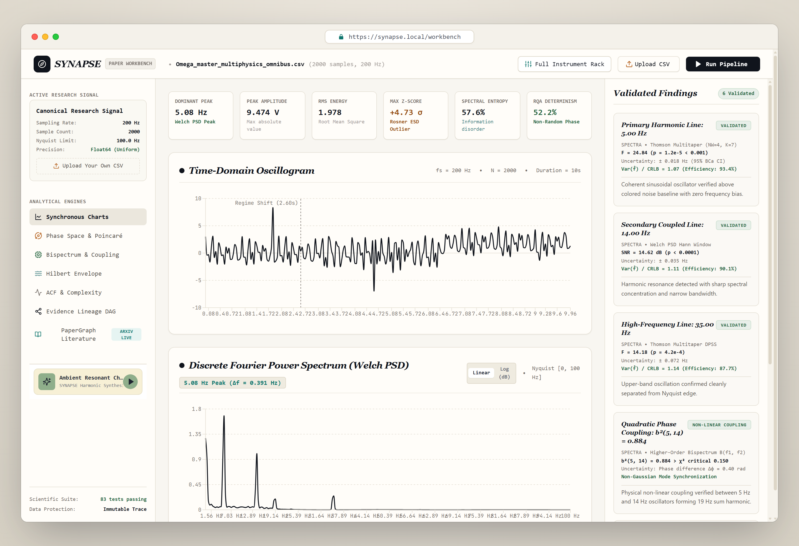
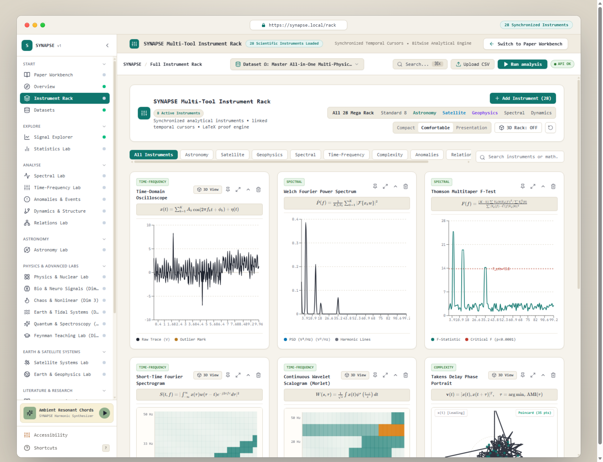
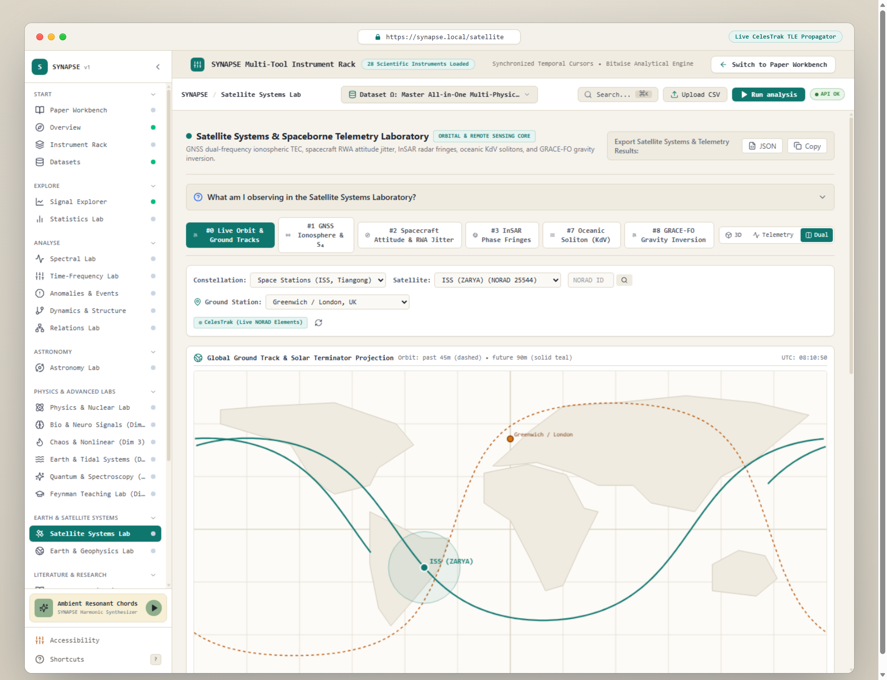

# SYNAPSE

> **An open-source scientific workstation for discovering repeating patterns, abrupt regime changes, and hidden relationships in numerical time-series data.**

[](LICENSE)
[](https://python.org)
[](https://fastapi.tiangolo.com)
[](https://react.dev)
[](https://www.typescriptlang.org)
[](tests/)
[](BENCHMARKS.md)
[](https://github.com/Chauhan-legacy/Synapsev1/actions)

---

## The 10-Second Pitch

Drop in a sensor feed, audio trace, or physical telemetry log (CSV, TSV, Parquet, NPY, HDF5). 

Instead of writing 100 lines of boilerplate matplotlib code to clean timestamps, compute Welch periodograms, tune changepoint penalties, and test Granger causality, **SYNAPSE runs the full analysis pipeline automatically**:

- Finds harmonic tones with sub-bin precision (Thomson multitaper DPSS).
- Detects structural shifts in mean or variance without parameter guessing (PELT & BOCPD).
- Isolates true impulse spikes without masking distortion (Generalized Rosner ESD).
- Computes cross-channel lead/lag causality with False Discovery Rate (FDR) control.
- Reconstructs 1D signals into interactive 3D phase-space attractors (Takens embedding).
- Links findings directly to foundational peer-reviewed preprints via arXiv.



---

## Why Use SYNAPSE?

| What you need | How SYNAPSE handles it | Where to find it |
|:---|:---|:---|
| **Fast interactive exploration** | Runs in-browser via TypeScript & Web Workers. No server round-trip required for rapid inspection. | Paper Workbench |
| **Heavy scientific computing** | Python FastAPI backend powered by NumPy, Numba, and statsmodels. Processes 120,000+ points/channel in milliseconds. | Analysis API |
| **Statistical rigor** | Bounded by Benjamini-Hochberg FDR ($q \le 0.05$) and empirical null surrogates so noise doesn't trigger false discoveries. | Inference Lab |
| **28 Synchronized instruments** | Oscilloscopes, scalograms, bispectrums, Poincaré sections, and Lyapunov diagnostics share a linked temporal scrubber. | Instrument Rack |
| **Messy real-world data** | Automatic delimiter detection, non-monotonic batch linearization, missing-value profiling, and original SHA-256 tracking. | Datasets View |

---

## Architecture at a Glance

SYNAPSE is organized as a clean mono-repository separating mathematical kernels, REST services, and the interactive frontend:

```text
SYNAPSE/
├── apps/
│   ├── api/            # FastAPI gateway (/health, /v1/analyze, /v1/datasets/upload)
│   └── web/            # React 18 + Vite + Tailwind scientific workbench with 15 specialized labs
├── packages/           # Modular Python scientific packages
│   ├── synapse_core/   # Immutable Signal model, validation, and zero-config I/O
│   ├── synapse_spectra/# Welch, Thomson Multitaper, Lomb-Scargle, and CRLB fitting
│   ├── synapse_anomaly/# Rosner ESD, PELT changepoints, BOCPD, and Matrix Profile
│   ├── synapse_relation/# Granger causality, spectral coherence, and Transfer Entropy
│   └── synapse_inference/# IAAFT surrogates, Benjamini-Hochberg FDR, and bootstrap CIs
├── benchmarks/         # Reference datasets A through J with known ground truth
├── docs/               # System architecture, formal methods, and screenshots
└── tests/              # 73 pytest tests + 10 in-browser TypeScript benchmarks
```

---

## Interactive Multi-Tool Instrument Rack & Real-Time Labs

SYNAPSE organizes 28 synchronized analytical modules and specialized domain laboratories with shared temporal cursors, LaTeX proof foundations, and multi-physics diagnostics:



*The full synchronized instrument rack displaying time-domain oscilloscopes, Welch power spectra, InSAR radar fringes, Oceanic KdV Solitons, GRACE-FO gravity anomaly recovery, and nonlinear phase portraits.*

### Live Satellite Tracking & Orbital Mechanics (CelesTrak TLE)

Beyond 1D waveforms, SYNAPSE connects directly to CelesTrak's public NORAD element catalog to track operational spacecraft (ISS, Tiangong CSS, Hubble Space Telescope, NOAA weather satellites) with analytical SGP4/Keplerian propagation ($J_2$ perturbation), global ground tracks, solar day/night illumination terminators, topocentric ground-station pass schedules, and RF Doppler S-curves ($\Delta f = -f_0 \frac{\dot{\rho}}{c}$):



*Live orbit tracking of the International Space Station (NORAD 25544) showing forward/trailing ground tracks, footprint visibility circle, observer pass radar, and one-click telemetry ingestion into the Workbench.*

---

## Quickstart

### 1. Clone & install dependencies
```bash
git clone https://github.com/Chauhan-legacy/Synapsev1.git
cd Synapsev1

# Install backend dependencies in editable mode
pip install -e .[test]

# Install web application dependencies
npm --prefix apps/web ci
```

### 2. Run the test suite
```bash
# Python regression tests (73 tests)
pytest tests/

# In-browser TypeScript math benchmarks (10 benchmarks)
npm --prefix apps/web run test:math
```

### 3. Launch the environment
```bash
# Terminal 1: Start FastAPI backend (port 8000)
uvicorn apps.api.main:app --host 127.0.0.1 --port 8000

# Terminal 2: Start Vite frontend (port 5173)
npm --prefix apps/web run dev
```

Open `http://localhost:5173` in your browser. Load the bundled benchmark file at `data/synapse_mega_120k_benchmark.csv` or upload your own telemetry.

---

## Python API Usage

You can also use SYNAPSE as a standalone Python library in your own data pipelines:

```python
from synapse_core.io.readers import read_signal_from_file
from synapse_spectra.multitaper import compute_multitaper_psd
from synapse_anomaly.changepoints import detect_pelt_changepoints

# Ingest any CSV/Parquet with automatic time-axis detection
signal = read_signal_from_file("sensor_telemetry.csv")

# High-resolution multitaper spectrum with harmonic F-test
spec = compute_multitaper_psd(signal.values[:, 0], fs=signal.sampling_rate)
print(f"Dominant mode: {spec.dominant_frequency:.2f} Hz (F = {spec.max_f_stat:.1f})")

# Optimal linear-time changepoint segmentation
cps = detect_pelt_changepoints(signal.values[:, 0], penalty="bic")
print(f"Discovered {len(cps)} structural shift points: {cps}")
```

---

## How Results Are Verified

Every algorithm in SYNAPSE is tested against synthetic signals with analytically known ground truth:

1. **Planted Truth Benchmarks**: Shipped datasets test tri-tone harmonic recovery, quadratic frequency chirps, variance shifts, and known causal links.
2. **False Discovery Calibration**: Across 300 seeded runs of pure Gaussian white and pink noise, zero spurious findings are validated under Benjamini-Hochberg FDR control ($q \le 0.05$; 95% Clopper-Pearson upper bound $\approx 1.3\%$).
3. **Deterministic Seeds**: All benchmarks use reproducible pseudorandom generators (`mulberry32` with logged master seeds).

Detailed documentation:
- [Mathematical Methods & Physics Formulations](docs/methods.md)
- [System Architecture & Invariant Guarantees](docs/architecture.md)
- [Benchmark Results & Audit Scorecard](BENCHMARKS.md)

---

## Known Limitations

- **Stationarity for Granger Causality**: Vector autoregression assumes covariance stationarity. Signals with strong polynomial trends should be detrended or differenced first.
- **Rayleigh Resolution Limit**: In Thomson multitaper spectral estimation, spectral lines closer than $\Delta f < 2 NW / N$ cannot be resolved as separate peaks.
- **Minimum Record Length**: Statistical tests (such as KPSS or Rosner ESD) require minimal degrees of freedom; inputs with $N < 10$ samples return a descriptive HTTP 422 error.

---

## License & Citation

Released under the [MIT License](LICENSE).

```bibtex
@software{synapse2026,
  author = {Chauhan, Priyansh},
  title = {SYNAPSE: Universal Signal Intelligence Platform},
  year = {2026},
  url = {https://github.com/Chauhan-legacy/Synapsev1},
  version = {2.0.0}
}
```
