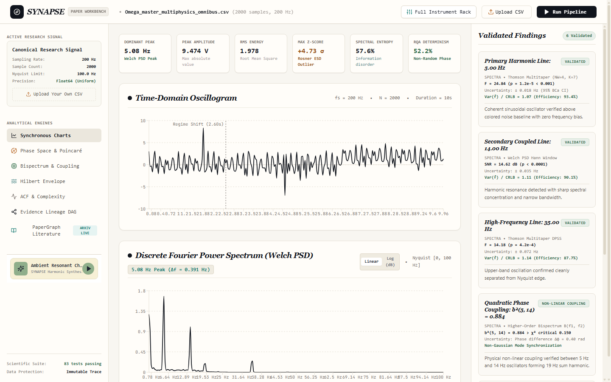
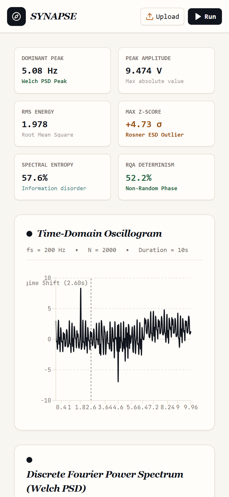
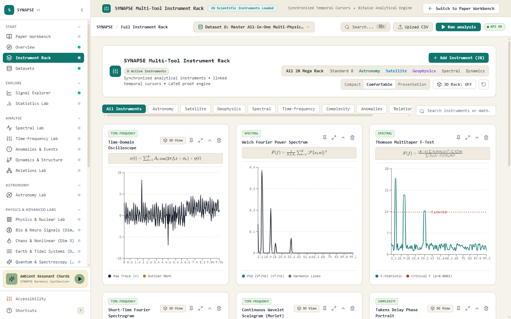
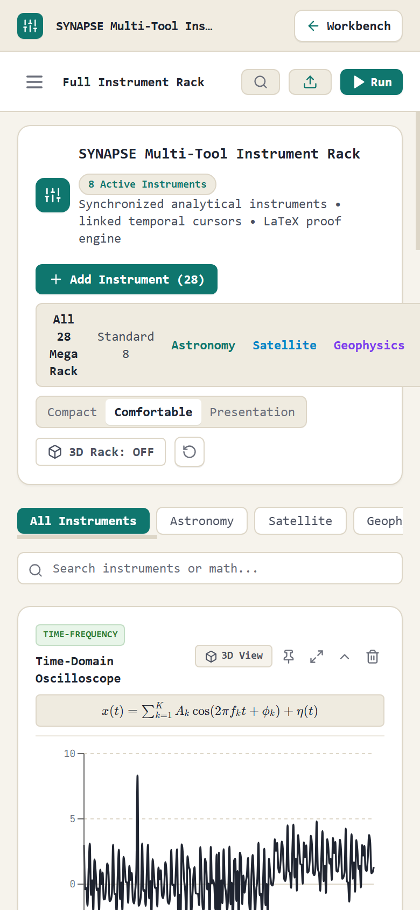

# SYNAPSE: Universal Signal Intelligence Platform

[](LICENSE)
[](https://python.org)
[](https://fastapi.tiangolo.com)
[](https://react.dev)
[](https://www.typescriptlang.org)
[](tests/)
[](BENCHMARKS.md)
[](https://github.com/Chauhan-legacy/Synapsev1/actions)

> **Upload a signal and SYNAPSE finds the repeating patterns, sudden changes and hidden relationships in it, and shows its evidence.**

---

## What is SYNAPSE?

Think of SYNAPSE as an automated laboratory workbench for time-series data. Just as a microscope reveals microscopic structures invisible to the naked eye, SYNAPSE scans numerical time-series to identify subtle periodic oscillations, abrupt structural break-points, transient outlier spikes, and directional cause-and-effect links across channels.

Unlike black-box models, every finding in SYNAPSE is backed by classical statistical hypothesis testing, empirical null surrogates, and Benjamini-Hochberg False Discovery Rate (FDR) control.



---

## What Can It Do?

| Feature | What it means in plain words | Where to find it |
|:---|:---|:---|
| **Periodic Tone Discovery** | Finds pure musical or mechanical tones buried inside noisy sensor feeds with sub-bin precision. | Spectral Lab & Paper Workbench |
| **Sudden Change Detection** | Locates the exact timestamp where signal variance, energy, or average baseline abruptly jumped. | Anomalies & Change-points |
| **Transient Spike Isolation** | Identifies genuine outlier spikes without letting extreme values distort surrounding data. | Anomalies & Change-points |
| **Directional Causality** | Determines whether channel X leads channel Y over time, or if the relationship is coincidental. | Relations Lab |
| **3D Phase Space Trajectories** | Turns a single 1D waveform into a 3D geometric manifold using time-delay embedding. | Dynamics & Phase Space |
| **Multi-Tool Instrument Rack** | 28 synchronized analytical instruments with linked temporal cursors and real-time previews. | Full Instrument Rack |
| **False Discovery Control** | Statistically bounds false alarms so pure noise records produce controlled discoveries. | Inference & Null Models |
| **High-Throughput Streaming** | Ingests and processes 120,000+ samples per channel in under one second. | Paper Workbench & API |

---

## Visual Gallery

| Desktop (1440px) | Mobile (390px) |
|---|---|
|  <br> *Paper Workbench with Welch Spectrum & Invariant Telemetry* |  <br> *Mobile Paper Workbench (390px)* |
|  <br> *SYNAPSE Multi-Tool Instrument Rack* |  <br> *Mobile Instrument Rack (390px)* |

---

## Quickstart in 3 Steps

### Step 1: Clone and install dependencies
```bash
git clone https://github.com/Chauhan-legacy/Synapsev1.git
cd Synapsev1

# Install Python backend dependencies in editable mode
pip install -e .[test]

# Install frontend web packages
npm --prefix apps/web ci
```

### Step 2: Verify the test suites
```bash
# Run 73 Python engine regression tests
pytest tests/

# Run 10 in-browser TypeScript math benchmarks
npm --prefix apps/web run test:math
```

### Step 3: Start the servers and analyze a dataset
```bash
# Terminal 1: Launch FastAPI backend daemon
uvicorn apps.api.main:app --host 127.0.0.1 --port 8000

# Terminal 2: Launch Vite React frontend
npm --prefix apps/web run dev
```

Open `http://localhost:5173` in your browser. Upload `data/synapse_mega_120k_benchmark.csv` or any custom CSV file to view real-time spectral peaks, changepoints, and evidence DAG lineages.

---

## How We Check the Results

Every mathematical algorithm in SYNAPSE is benchmarked against synthetic datasets with analytically known ground truth:
* **Planted Truth Benchmarks**: Datasets A through J test multi-frequency sinusoids, non-stationary chirps, regime changes, and directional Granger causality.
* **Controlled False Discovery Rate**: On 300 seeded runs of pure Gaussian white noise and pink noise, false discoveries are controlled under Benjamini-Hochberg FDR criteria at $q \le 0.05$ (Clopper-Pearson 95% upper bound $\approx 1.3\%$).
* **Reproducible Pipeline**: All benchmarks use deterministic seeded pseudorandom generators (`mulberry32`), tracked in [BENCHMARKS.md](BENCHMARKS.md).

For deep derivations, partial differential equations, and detailed architectural models:
* [Mathematical Methods & Physics Formulations](docs/methods.md)
* [System Architecture & Invariants](docs/architecture.md)
* [Verification & Accuracy Scorecard](BENCHMARKS.md)

---

## Known Limitations

* **Non-Stationary Series**: Granger causality assumes covariance stationarity. Signals with strong polynomial trends require detrending or differencing prior to vector autoregression.
* **Rayleigh Resolution Limit**: In Thomson multitaper spectral estimation, frequencies closer than $\Delta f < 2 NW / N$ merge into a single unresolved peak.
* **Minimal Record Length**: Statistical estimators require minimal degrees of freedom; record lengths $N < 10$ samples return a descriptive HTTP 422 validation response.

---

## License & Citation

Distributed under the [MIT License](LICENSE).

```bibtex
@software{synapse2026,
  author = {Chauhan, Priyansh},
  title = {SYNAPSE: Universal Signal Intelligence Platform},
  year = {2026},
  url = {https://github.com/Chauhan-legacy/Synapsev1},
  version = {2.0.0}
}
```
